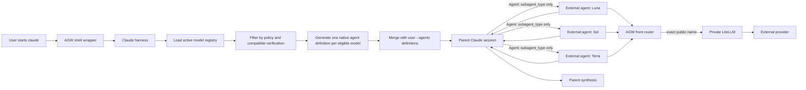

# Claude External Subagents Design

**Status:** Approved for implementation planning  
**Date:** 2026-08-14  
**Execution mode:** Inline Execution (`superpowers:executing-plans`)

## Summary

AGW will make every eligible active external model available to the normal parent Claude session as a named native Claude Code agent type. Claude can then autonomously choose one or more models, launch their agents concurrently through the built-in Agent tool, and synthesize their results.

No special orchestration command is required. With AGW's managed shell integration enabled, the everyday entry point is `claude`; `agw claude` is the explicit equivalent. `command claude` continues to bypass AGW.

The Agent tool's explicit `model` argument accepts only Claude-family enum values in the current client. AGW will therefore encode each external model in a custom agent definition and have Claude select only `subagent_type`. The external public model name is never passed through the enum-constrained tool argument.

This is a native-subagent-first design. It is gated by a live compatibility probe because Anthropic does not support non-Claude gateway models and Claude Code may replace a definition-level model under managed `availableModels`. An independent top-level Claude child remains a fallback only if native custom-agent routing is proven impossible.

## Goal

A user can ask the parent Claude session for multiple perspectives without selecting every worker manually:

```text
Review this change with several available models and synthesize the findings.
```

Claude may then launch, for example, three built-in Agent calls concurrently:

```text
subagent_type: agw-gpt-5-6-luna-<digest>
subagent_type: agw-gpt-5-6-sol-66127d2195a1
subagent_type: agw-gpt-5-6-terra-<digest>
```

Each type has a static definition-level model (`gpt-5.6-luna`, `gpt-5.6-sol`, or `gpt-5.6-terra`). Results return through Claude Code's normal subagent lifecycle for the parent to compare and synthesize.

## Requirements

### Functional

- **FR-1:** Every active external registry entry that has passed the external-subagent compatibility gate has one generated native agent definition at Claude launch.
- **FR-2:** The parent Claude session can discover the generated types and autonomously decide whether to launch zero, one, or many of them.
- **FR-3:** Different external-model agent types can run concurrently in one parent session.
- **FR-4:** Invocation selects only `subagent_type`; it omits the Agent tool's explicit `model` override.
- **FR-5:** Each definition preserves the exact public model name from `ModelRegistry`. Display labels and sanitized agent IDs never become routing aliases.
- **FR-6:** The parent receives each native subagent's normal final result and remains responsible for synthesis and any subsequent action.
- **FR-7:** Plain `claude` works when AGW shell integration is enabled. `agw claude` remains the canonical explicit/debug form.
- **FR-8:** A model that is inactive, incompatible, unverified, stale-verified, or restricted by policy is not advertised as an external agent type. Existing proxy startup continues to fail fast if authentication is not ready for any provider backing an active model.
- **FR-9:** The compatibility gate never records a different external model or native inheritance as a successful exact-model run. A verified definition still relies on Claude Code's launch-time model resolution; runtime failures are surfaced and are not retried on another external model.
- **FR-10:** Council integration is a follow-up that must reuse the same model-to-agent-definition resolver if implemented.

### Safety and privacy

- **SR-1:** External agents are available only for models the user explicitly enabled in AGW's registry. Managed launch retains the existing requirement that every provider backing an active model is authenticated.
- **SR-2:** Generated descriptions clearly state that the type uses an external provider, so Claude has a meaningful orchestration signal.
- **SR-3:** AGW adds only the delegated prompt and generated agent definition; it does not copy the complete parent transcript. Claude Code still supplies its normal custom-subagent context, including the loaded CLAUDE.md hierarchy, environment details, and git-status snapshot, and the agent may read repository content through allowed tools.
- **SR-4:** Generated external agents receive only the built-in `Read`, `Grep`, and `Glob` tools in v1. They cannot recursively invoke Agent or Workflow, access MCP/web tools, run shell commands, or edit files.
- **SR-5:** Generated definitions do not request a permission-mode override. AGW does not introduce a more permissive mode.
- **SR-6:** Provider credentials, AGW's private LiteLLM key, and Claude authentication material retain the existing process-isolation boundary.
- **SR-7:** Compatibility evidence contains model, provider, Claude executable identity/version, routing fingerprint, definition contract version, timestamps, and outcome only - never prompts, response bodies, tokens, or credentials.

## Non-goals

- Showing every external model in Claude Code's visual `/model` picker.
- Widening or patching the built-in Agent tool's explicit `model` enum.
- Asking the user to select every worker in every prompt.
- Automatically spawning multiple agents on every task.
- Reimplementing Claude Code's agent loop directly against provider APIs.
- Treating external agents as trusted with unrelated transcript or repository context.
- Silently enabling inactive models, authenticating providers, or changing managed Claude policy.
- Making agent-team panes the v1 runtime. Native in-process subagents are the primary lifecycle.
- Letting generated external agents mutate the worktree in v1. Editing and shell-capable variants require a separate safety design after the read-only path is proven.
- Integrating the in-progress Council feature in the first compatibility slice.

## Existing constraints

### One visual picker entry

Claude Code's saved-login plus custom-header configuration does not run multi-model gateway discovery in the tested client. AGW preserves the saved Claude subscription and exposes only one cosmetic external picker entry through `ANTHROPIC_CUSTOM_MODEL_OPTION`. Direct main-session `/model NAME` and `--model NAME` already work for other active names.

This design does not alter that trade-off. Agent definitions are a separate discovery surface from the main model picker.

### Agent override rejection

A live Agent call with `model: gpt-5.6-sol` fails client-side before reaching AGW:

```text
InputValidationError: expected one of "sonnet"|"opus"|"haiku"|"fable"
```

Claude Code custom-agent definitions have their own `model` field, and the installed client documents resolution precedence as environment override, per-invocation override, definition frontmatter, then parent inheritance. AGW already removes `CLAUDE_CODE_SUBAGENT_MODEL`. The intended path therefore relies on definition frontmatter and omits the per-invocation override.

### Managed model restriction

Claude Code checks definition-level models against managed `availableModels`. A disallowed non-family model may be replaced by the inherited parent model with a warning. A subagent returning a response is therefore not sufficient evidence that the external model ran.

### Unsupported upstream combination

Anthropic explicitly does not support routing Claude Code to non-Claude models through a gateway. The current main-session path works empirically. External subagents must remain version-pinned and compatibility-gated rather than claimed from documentation alone.

## Architecture



### Components

1. **External agent-definition builder**
   - Pure logic derived from `ModelRegistry.active_models()`.
   - Maps each eligible model to a deterministic agent type and Claude `--agents` object.
   - Owns name sanitization, collision resistance, descriptions, tool restrictions, and turn bounds.

2. **Compatibility store and resolver**
   - Records successful controlled probes without secrets or content.
   - Keys evidence to the exact public model, provider route, resolved Claude executable path/digest/version, definition contract version, and AGW runtime/routing fingerprint.
   - Makes stale evidence fail closed.

3. **Claude launch-argument merger**
   - Recognizes `--agents JSON` and `--agents=JSON` only before the `--` option terminator.
   - Parses and validates the user object.
   - Adds AGW-owned definitions without changing user-owned definitions.
   - Emits one deterministic `--agents` argument.

4. **Compatibility probe**
   - Starts a bounded, noninteractive Claude process using the configured native executable and one temporary external agent definition.
   - Instructs the parent to invoke that named type without an explicit model override.
   - Requires correlated front-router evidence that the exact public model took the external route.
   - Stores only a sanitized pass/fail result.

## Agent definitions

### Identity

Claude agent names have a narrower practical namespace than AGW public model names. AGW must not use punctuation replacement alone because distinct names can collapse to the same slug.

The generated type is:

```text
agw-<sanitized-model-prefix>-<short-stable-hash>
```

For example:

```text
gpt-5.6-sol -> agw-gpt-5-6-sol-66127d2195a1
```

The readable prefix is formed by lowercasing the exact public model name, replacing each maximal run of non-`a-z0-9` characters with `-`, trimming leading/trailing hyphens, and truncating it to 40 characters. The suffix is the first 12 lowercase hexadecimal characters of SHA-256 over canonical UTF-8 JSON with sorted keys and compact separators:

```json
{"contract":1,"model":"gpt-5.6-sol","provider":"chatgpt"}
```

With definition contract version 1, the example type is `agw-gpt-5-6-sol-66127d2195a1`. The digest input and 48-bit suffix are a deterministic namespace, not a security boundary. The readable prefix is diagnostic only. The definition's `model` field and router payload retain `gpt-5.6-sol` exactly.

Generated IDs use an AGW-reserved prefix. A same-name user CLI definition is a hard launch conflict. Higher-priority managed definitions cannot be enumerated reliably before Claude loads them, so the live probe must confirm that `SubagentStart.agent_type` and exact route evidence match the generated definition; AGW documents the reserved prefix and `agw doctor` reports any inspectable managed collision. AGW never overwrites a user definition or treats an uncorrelated same-name definition as verified.

### Shape

Conceptually, each generated entry is equivalent to:

```json
{
  "agw-gpt-5-6-sol-66127d2195a1": {
    "description": "Use the external AGW model gpt-5.6-sol (ChatGPT) for an independent read-only perspective. Repository content read by this agent is sent to ChatGPT. Multiple AGW model agents may run concurrently when their perspectives add value.",
    "prompt": "Complete only the delegated analysis task. Use only the provided read-only repository tools. Do not attempt to modify files or invoke external services. State limitations clearly and return a concise result to the parent.",
    "model": "gpt-5.6-sol",
    "tools": ["Read", "Grep", "Glob"],
    "maxTurns": 20
  }
}
```

Definition contract version 1 is pinned to Claude Code 2.1.232 and emits only `description`, `prompt`, `model`, `tools`, and `maxTurns`. `tools` is the complete allowlist; Claude Code documents that an explicit built-in allowlist excludes MCP tools, and omitting Agent prevents recursive subagents. V1 deliberately excludes Bash, Edit, Write, Skill, web, MCP, and orchestration tools. This keeps autonomous multi-model fan-out analysis-only while the unsupported model path is being established.

### Description as orchestration policy

Claude decides which types to use from their descriptions. Every generated description must communicate:

- exact model and provider;
- that data may leave the machine for that provider;
- appropriate uses such as independent review, analysis, or comparison;
- that multiple AGW agents may be run in parallel;
- that the type must not be selected merely to spend quota or duplicate work without value.

AGW does not assign fixed roles such as “reviewer” or “builder” to models. The parent supplies the perspective in each task prompt.

## Launch behavior

### Normal entry point

`agw setup` enables a marker-guarded shell wrapper by default. In that configured shell:

```text
claude ...     -> agw claude ...
agw claude ... -> explicit equivalent
command claude -> native bypass
```

Both managed entry points build the same definitions at every new session. No plugin enablement or restart is needed for registry synchronization.

### Eligibility

An active registry model is advertised only when all conditions hold:

1. It is not excluded by an inspectable `availableModels` policy.
2. It has a successful external-subagent probe matching the current:
   - resolved Claude executable path, SHA-256 digest, and `claude --version` output;
   - exact public model and provider route;
   - AGW runtime fingerprint, which already covers the routing ABI, AGW version, LiteLLM version, and rendered routing configuration;
   - generated definition contract version.
3. No user CLI agent-definition collision exists.

Provider authentication is not a per-model omission filter in v1. The existing proxy startup invariant remains unchanged: if any provider backing an active model is not authenticated, managed Claude launch fails before agent injection with the provider's remediation. Once the proxy is ready, the parent receives no externally advertised type lacking current compatibility evidence. `agw doctor` explains omissions and proxy-startup blockers.

### Merging user definitions

If the forwarded invocation contains no `--agents`, AGW appends its generated object.

If it contains one user object, AGW:

1. Parses JSON as an object.
2. Preserves the parsed JSON value of every user key exactly in the merged object. Whitespace, key order, and escape spelling may change when JSON is serialized.
3. Checks all generated IDs for collision.
4. Adds only non-colliding AGW definitions.
5. Emits one merged object at the position of the original pre-terminator option, using the two-token `--agents JSON` form.

Malformed JSON, a non-object root, duplicate `--agents` options, or an AGW ID collision fails before Claude starts. Diagnostics identify the option or generated ID but never echo the user-supplied JSON value, because custom definitions can contain sensitive prompts or server configuration. Values after `--` are positional prompt content and are never interpreted as launcher options.

If no model is eligible, AGW leaves user arguments unchanged instead of passing an empty generated object.

## Runtime flow

1. Parent Claude receives generated types in the built-in Agent tool's `subagent_type` choices.
2. Claude selects appropriate model types based on the task, user constraints, and descriptions.
3. Claude may issue several independent Agent calls in one turn so Claude Code runs them concurrently.
4. Each call supplies:
   - `subagent_type`: generated AGW type;
   - a bounded task prompt and selected context;
   - no external value in the explicit `model` field.
5. Claude Code resolves the definition-level external model and sends requests to `ANTHROPIC_BASE_URL` with the existing local key.
6. The front router matches the exact model and removes Claude credentials before forwarding to private LiteLLM.
7. Each native subagent returns its final answer through Claude Code.
8. The parent compares, reconciles disagreements, and responds to the user.

The parent may also choose native Claude agents in the same fan-out. AGW does not force a particular panel composition.

## Compatibility and runtime guarantees

### Verification gate, not runtime pinning

The compatibility record proves behavior for a specific Claude executable and AGW routing build under a controlled probe. Claude Code does not expose a supported runtime assertion that binds every future `Agent` call to the definition-level model before its first request. V1 therefore uses router-side registration only inside the controlled compatibility probe; it does not register ordinary spawns or claim per-spawn fail-closed enforcement.

During ordinary sessions, exact external model names still route without AGW fallback. If Claude Code resolves a verified definition differently at runtime, that worker may use the inherited native model before AGW can identify the mismatch. Such a result is a Claude Code compatibility regression, not a successful external run; rerunning `agw models verify NAME --claude-subagent` must fail, but AGW cannot retroactively invalidate the existing record from an unobserved ordinary spawn. Strong per-spawn enforcement would require durable agent-ID registration, hook-failure semantics, restart handling, expiry, and cleanup, and is explicitly deferred.

### Compatibility probe

#### Why it is mandatory

The central unknown is not whether top-level `/model gpt-5.6-sol` works; that is already observed. It is whether the tested Claude version:

- accepts an external name from a custom-agent definition;
- lets Agent omit the per-call model override;
- avoids `availableModels` substitution;
- preserves native subagent tool use through AGW's protocol adapters.

#### Command surface

Extend model verification with the explicit `--claude-subagent` flag rather than performing model calls during ordinary launch:

```bash
agw models verify gpt-5.6-sol --claude-subagent
```

The command must disclose that it runs bounded Claude and external-provider model calls. It is never run automatically by setup, doctor, or `claude` launch.

#### Pass condition

A probe passes only when all of the following are observed:

- The parent selected the expected generated `subagent_type`.
- No external model was placed in Agent's explicit enum-constrained override.
- `SubagentStart` recorded the expected generated `agent_type` and its unique `agent_id`.
- At least one request carrying that exact `x-claude-code-agent-id` reached AGW under the exact public model.
- The router selected the expected provider route.
- The subagent completed a minimal `Read` tool-use round trip and returned to the parent.
- No client warning or structured evidence reports model restriction/substitution.

A plausible answer, successful process exit, or provider response without exact route correlation is not enough.

#### Route correlation

The current router intentionally persists no request metadata. Verification uses Claude Code 2.1.232's existing lifecycle signals rather than inventing a custom request header:

1. The probe launches Claude with two inline CLI agent definitions: the generated external worker and a native verifier parent selected with `--agent`. The verifier parent has an Agent-only tool contract and command hooks for `PreToolUse` matching Agent plus `SubagentStart` matching the exact generated worker type. Inline `--agents` hooks are explicit session configuration and do not depend on project workspace trust. The bounded initial prompt instructs this parent to make exactly one Agent call; no general-purpose main-session tools are available.
2. The hooks append newline-delimited JSON events to one pre-created regular `0600` file opened with `O_APPEND|O_NOFOLLOW`; each record stays below `PIPE_BUF`. The helper validates the file owner, mode, inode, and dedicated probe-directory containment before every write. `PreToolUse` records only `tool_use_id`, `subagent_type`, and whether the optional explicit `model` key was absent. If the type is wrong, `model` is present, or more than one Agent call is attempted, it returns `hookSpecificOutput.permissionDecision: "deny"` and blocks the Agent call. It stores no delegated prompt or description.
3. The same synchronous `SubagentStart` helper appends only `agent_id` and `agent_type`, then registers the route authorization with the running router, and returns only after that registration succeeds. Its exit status cannot block startup, so missing or malformed evidence makes the probe fail rather than stopping the child.
4. Claude Code allocates the child's id and drains every matching `SubagentStart` hook before starting the child's model loop, so registering inside the hook necessarily precedes the child's first model request. That closes the race: no verifier polling window can authorize the route after startup has already begun. Claude Code sends `x-claude-code-agent-id` on subagent API requests, and the registration is a loopback-only, `X-AGW-Key`-authenticated control-endpoint call carrying the agent ID, expected public model/provider, unpredictable probe nonce, and pre-opened evidence-file identity under AGW state. The endpoint rejects registrations outside the dedicated probe directory or whose model/provider are not active exact routes. Only a matching subsequent request may consume the registration and append one route event containing the nonce, agent ID, requested public model, resolved public model/provider, request kind, timestamp, and no body, response, auth header, or tool content.
5. After the child exits, the verifier joins the three event types by expected type, agent ID, and probe nonce, and removes the probe file on success or failure. The router registration is one-shot and expires after 60 seconds; a stale, repeated, unknown, or mismatched ID/nonce cannot satisfy the probe.

Probe files live in a dedicated directory under AGW's state root with `0700` parent directories and per-run unpredictable filenames. The child hook process receives only the specific event path and expected type via its environment; provider credential directories and the LiteLLM key remain scrubbed. The router removes `x-claude-code-agent-id` and `x-claude-code-parent-agent-id` before forwarding external requests so those Claude lifecycle identifiers remain local. Ordinary sessions do not register probes or persist per-request evidence in v1.

#### Stored evidence

A successful record contains:

```text
schema version
public model
provider
Claude executable identity and version
AGW/runtime routing fingerprint
definition contract version
verified timestamp
outcome
```

Any relevant change makes the record stale and removes that type from future sessions until explicitly reverified.

## Context and permission policy

### Context

Custom subagents begin with isolated conversation context, but Claude Code also supplies its normal subagent environment, loaded CLAUDE.md hierarchy, and git-status snapshot. AGW does not suppress or rewrite those native inputs. The parent authors the delegated task message; for multi-model deliberation, that message should contain only:

- task statement and agreed constraints;
- explicitly selected file paths or excerpts;
- decisions and non-goals;
- requested perspective and output shape.

These match Council's existing context capsule categories. AGW does not inject parent transcript history.

The agent can read other repository files using its tools if the delegated task and inherited permissions permit it. Documentation must therefore state plainly that repository content read by an external agent is sent to that external provider as model input.

### Permissions

Native subagents inherit the parent's permission boundary. Definitions do not request `bypassPermissions`, any other `permissionMode`, persistent memory, skills, or MCP servers. The explicit `Read`, `Grep`, and `Glob` allowlist excludes Agent, Workflow, Bash, editing, web, Skill, and MCP tools. Generated agents can inspect repository content but cannot modify the worktree through their v1 tool contract.

Because v1 is analysis-only, concurrent external agents cannot create file-level write conflicts through generated tools. AGW does not create worktrees automatically. A future edit-capable contract must separately specify worktree isolation, permission inheritance, command safety, and result integration.

## Errors and diagnostics

| Condition | Behavior |
|---|---|
| Explicit Agent `model: gpt-*` attempted | Skill guidance tells Claude to use the generated `subagent_type`; client rejection is surfaced if it still occurs. |
| Active model has no current probe | Omit type; doctor reports “external subagent not verified.” |
| Provider auth missing/expired for any active model | Preserve existing fail-fast proxy startup; doctor names provider remediation. |
| Inspectable `availableModels` excludes model | Omit type and warn; do not rely on Claude's substitution. |
| Uninspectable managed policy substitutes model during probe | Probe fails from missing exact route evidence or restriction evidence. |
| User `--agents` malformed | Abort launch before `execve`; preserve and quote no sensitive argument values in diagnostics. |
| Generated ID collides with user CLI definition | Abort launch with the ID and remediation; never overwrite. |
| Managed definition uses an AGW-reserved ID | Inspectable collision is diagnosed; otherwise exact live verification cannot pass for that executable/policy combination. |
| Model removed or disabled | Definition disappears on the next managed Claude launch. |
| Registry changes while session is open | Existing session retains its launch snapshot; a new session reflects changes. Proxy fingerprint rules remain unchanged. |
| External provider fails after spawn | Subagent fails under the exact public model/provider; parent may continue with other results but must disclose the missing perspective. |
| Claude upgrade | Evidence becomes stale; external types remain omitted until reverified. |

## Follow-up integration and existing features

### Model routing skill

The skill must stop instructing Claude to pass an external name through Agent's `model` field. It should instead:

1. Read the generated type mapping available to the session.
2. Select the type corresponding to the exact requested model.
3. Omit the explicit model override.
4. Use multiple generated types concurrently when useful or requested.
5. Surface missing types as eligibility/verification problems, never substitute.

### Council (follow-up)

Council is not part of the first external-subagent compatibility slice. After the native generated-type path has passed live verification, Council may resolve an eligible external seat through the same builder and compatibility store. Its explicit preflight and context capsule remain useful, but it must not introduce a parallel execution mechanism.

The existing dirty Council implementation is preserved during the core work and reconciled only in that follow-up.

### Companion usage plugin

The personal skills-directory companion plugin remains dedicated to `/agw-usage`. AGW does not generate `agents/*.md` there because:

- the installed plugin may be disabled or stale;
- model activation is per-user and dynamic;
- setup's ownership allowlist is intentionally static and non-destructive;
- model-backed execution would blur the plugin's zero-model-call usage contract.

### Agent teams

Agent teams are not required for this feature. If future Claude versions expose a safe equivalent definition-level model path for teammates, it can reuse the builder and compatibility record. V1 makes no agent-team compatibility claim.

## Alternatives considered

### Plugin-shipped agent files

**Advantages:** native subagent semantics and plugin-scoped names.

**Rejected as primary:** the current companion plugin is independently enableable, may be disabled/stale, and cannot naturally mirror per-user active models without reinstall/update complexity. It faces the same definition-model compatibility question as `--agents`.

### Independent Claude CLI children through MCP

**Advantages:** top-level `--model gpt-5.6-sol` is known to accept exact external names and bypasses the Agent enum.

**Fallback only:** this creates an independent session, not a native child context. AGW would need to recreate context transfer, permissions, cancellation, timeout, cleanup, recursion prevention, and output collection. If native definition routing fails the probe, this option requires a separate design approval before implementation.

### Direct provider-native agent loop

**Rejected:** it would recreate Claude Code's tool orchestration, permission system, lifecycle, and protocol compatibility. It is substantially broader than the requested feature.

### Global `CLAUDE_CODE_SUBAGENT_MODEL`

**Rejected:** it applies globally rather than per agent, prevents mixed-model fan-out, can be policy-substituted, and defeats exact task-level selection. AGW continues stripping it.

## Testing strategy

### Unit tests

- Exact deterministic model-to-agent ID mapping.
- Collision resistance for public names that sanitize to the same prefix.
- Exact model/provider preservation in generated definitions.
- Eligible-only filtering across active state, policy, compatibility, and staleness, while provider auth retains the existing global fail-fast invariant.
- Exact v1 tool allowlist contains only `Read`, `Grep`, and `Glob`.
- User `--agents` merge preserves parsed JSON values semantically and rejects conflicts.
- Option parsing handles `--agents VALUE`, `--agents=VALUE`, `--`, missing values, malformed JSON, non-object roots, and duplicate options.
- Existing custom-header and secret-scrubbing behavior remains unchanged.
- `CLAUDE_CODE_SUBAGENT_MODEL` remains removed.
- Compatibility record invalidates on every fingerprint component.

### Contract and integration tests

- Fake Claude captures one merged `--agents` object on normal launch.
- Plain shell-wrapped `claude` and explicit `agw claude` reach identical launch construction.
- User agent definitions coexist without mutation.
- When no generated definitions exist, launcher arguments are forwarded byte-for-byte.
- The native verifier parent exposes only the intended Agent capability; probe hooks reject an explicit Agent model override, wrong type, or second Agent call and record only allowlisted metadata.
- Router correlation strips Claude agent-ID headers before external forwarding and records only allowlisted metadata in probe mode.
- Probe orchestration rejects process success, missing hook evidence, or route evidence for a different agent ID/model/provider.
- Probe failure never writes a successful eligibility record.
- Omitted types and reasons appear in doctor output.

### Live compatibility tests

For every external model claimed as subagent-capable on the pinned Claude version:

- Definition-level selection succeeds with no per-call external `model` override.
- Exact model/provider route evidence correlates to the spawned worker.
- Minimal Read/tool-use/result round trip succeeds.
- Two distinct external types run concurrently and return distinct results.
- Parent synthesizes both results.
- A managed restriction produces a failed probe, never a passing native-inheritance result.
- Cancellation and external upstream failure return control to the parent.
- Persisted logs contain no prompt/body/tool-content canary.

Live tests stay manual or `live`-marked and never run in CI.

## Documentation updates

Implementation must correct current claims that external names can be passed as per-invocation Agent model overrides:

- `README.md`
- `docs/model-selection.md`
- `docs/compatibility-report.md`
- `docs/security.md`
- `docs/operations.md`
- `skills/model-routing/SKILL.md`
- relevant doctor wording and manual test instructions

The updated user-facing explanation should be:

- start ordinary `claude` after managed shell setup (or explicit `agw claude`);
- eligible active external models appear to Claude as agent types, not necessarily in `/models`;
- Claude can choose and run multiple types itself;
- exact external subagent support is version- and verification-gated;
- the controlled compatibility gate cannot be satisfied by silent substitution; ordinary per-spawn enforcement is not claimed in v1.

## Acceptance criteria

- [ ] **AC-1:** In a managed `claude` session, the Agent tool exposes one generated type for every eligible active external model.
- [ ] **AC-2:** No generated external type appears for an inactive, policy-excluded, unverified, or stale-verified model; missing authentication for any active provider preserves the existing fail-fast launch behavior.
- [ ] **AC-3:** Claude can launch at least two different external types concurrently without passing an external value through Agent's explicit `model` field.
- [ ] **AC-4:** Sanitized probe evidence, joined by expected type, agent ID, and nonce, proves each tested spawned type used its exact public model and configured provider.
- [ ] **AC-5:** The parent receives both results and can synthesize them through native Claude Code behavior.
- [ ] **AC-6:** Native-model inheritance/substitution cannot satisfy the controlled compatibility gate; v1 documentation does not claim fail-closed enforcement for every ordinary spawn.
- [ ] **AC-7:** Existing user `--agents` definitions preserve their parsed JSON values; malformed input and collisions fail before launch.
- [ ] **AC-8:** The generated v1 contract exposes only `Read`, `Grep`, and `Glob`, so external agents cannot edit, run shell commands, recursively spawn agents, invoke skills, or access MCP/web tools.
- [ ] **AC-9:** Existing Claude saved-login routing, provider credential isolation, and shell bypass behavior remain unchanged.
- [ ] **AC-10:** Offline tests pass and the live report records the pinned Claude executable identity/version and exact two-model fan-out evidence.

## Rollout

1. Add pure definition/argument-building logic and offline tests.
2. Add privacy-preserving probe correlation and compatibility storage.
3. Add the explicit live verification mode without advertising agents by default.
4. Run and record the live probe on the pinned Claude version for at least two active external models.
5. Enable launch-time injection only for successful, current records.
6. Update user-facing claims.
7. Treat a Claude executable/version change as compatibility invalidation, not an automatic rollout.
8. Reconcile Council only as a follow-up after the core path is proven.

Rollback disables launch-time generation while leaving main-session external routing untouched. It does not change or remove provider credentials, the model registry, or the standalone `/agw-usage` integration.

## Implementation boundary

Implementation begins only after a separate executable plan is reviewed. It must preserve the pre-existing dirty Council changes and must not add, commit, or push on the user's behalf.
